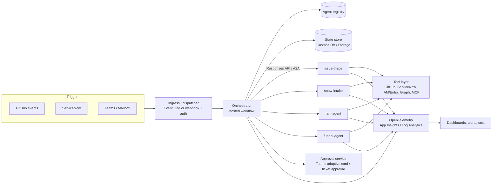

# Feature Spec: Multi-Agent Orchestration Platform on Foundry

Status: Draft. Basis: the existing issue triage workflow (`workflow/IssueTriageWorkflow`).

## 1. Goal

Run many agents on Azure AI Foundry that are:

- **Orchestrated**: a shared orchestrator sequences agents and hands work between systems.
- **Monitored**: live status, run history, outcomes and cost per agent.
- **Governed**: the same identity, approval, audit and security rules for every use case.

Triage is the first use case. The platform must carry the use cases below without changes to its core.

## 2. Use cases

| ID | Use case | Flow |
|----|----------|------|
| UC1 | GitHub issue triage (exists) | Issue event, triage agent, comment and labels, size-specific branch |
| UC2 | ServiceNow to IAM and back | ServiceNow request, intake agent classifies and validates, **handover to IAM agent** (access change), result written back to the ServiceNow ticket, ticket closed or escalated |
| UC3 | Teams chat / email funnel | Teams message or mailbox, funnel agent classifies intent, extracts data, routes to a fitting agent or creates a ticket or issue, and replies to the sender |

Common shape: **trigger, intake and classify, (approval), act through tools, report back, audit**.

## 3. Principles

1. **Models decide, code acts.** Side effects (writes, access changes, messages) are done by deterministic code on validated, structured output. The model never holds write credentials. This is the existing rule in the triage workflow and it applies everywhere.
2. **Untrusted input.** Tickets, mails, chats and issue text are untrusted. No tool reachable from that content may write without validation or approval.
3. **Contract first.** Every agent has a versioned input/output schema.
4. **Stateless runs, durable state outside.** Long-running flows keep state in a store, not in the process.
5. **One governance model.** Identity, approvals, audit, limits and telemetry are shared platform capabilities, not per-agent code.

## 4. Architecture



### Components

| Component | Responsibility | Foundation in this repo |
|-----------|----------------|-------------------------|
| Agents | One purpose each, structured I/O, no side effects | `agents/` |
| Tools | Integrations with least-privilege credentials | `tools/` (add `ServiceNowTools`, `IamTools`, `GraphTools`) |
| Workflows | Executors composed with `WorkflowBuilder`, hosted as Foundry agents | `workflow/` |
| Orchestrator | Calls other agents and workflows, handles handover and routing | New: `workflow/Orchestrator` |
| Dispatcher | Receives events, authenticates, maps event to workflow | New (replaces per-repo caller workflows for non-GitHub triggers) |
| Registry | Catalog of agents with endpoint, schema, owner, permissions, version | New: file or table, later from the Foundry API |
| State store | Correlation ID, step, approvals, external IDs (ticket, issue) | New |
| Approval service | Human-in-the-loop gates | New |
| Observability | Traces, metrics, logs, cost | New (Terraform + OTel) |
| Infrastructure | Foundry, Key Vault, identities, roles | `infrastructure/` |

## 5. Functional requirements

### 5.1 Agent contract and registry

- **FR-1** Each agent publishes a versioned JSON schema for input and output and a short capability description.
- **FR-2** The registry lists name, version, endpoint, owner, risk level, required tools and permissions, and allowed callers.
- **FR-3** The orchestrator calls agents only through the registry (allowlist). Unknown agents cannot be called.
- **FR-4** Contract tests run in CI for every agent change.

### 5.2 Orchestration

- **FR-5** A `RemoteAgentExecutor` calls another hosted agent through its Responses endpoint, with timeout, retry and idempotency key.
- **FR-6** Two modes: deterministic workflows for known pipelines (UC1, UC2) and an LLM router for open intake (UC3). The router can only select from the registry, has a maximum step count, and holds no write tools.
- **FR-7** A **handover** carries a typed payload (the case) plus correlation ID, origin system and reference (for example the ServiceNow ticket number), so the result can be returned to the origin.
- **FR-8** Every flow ends in a defined outcome: completed, rejected, escalated to a human, or failed. Nothing ends silently.

### 5.3 State and long-running flows

- **FR-9** Each case has a record with correlation ID, current step, history, external references and status.
- **FR-10** Flows can wait for an approval or an external event and resume. They use workflow checkpoints plus the state store.
- **FR-11** Handlers are idempotent. A repeated event does not repeat a side effect. For GitHub, labels remain the state (as today).

### 5.4 Human in the loop

- **FR-12** Actions above a configurable risk level need approval. IAM changes always do, unless a policy explicitly allows auto-approval.
- **FR-13** Approvals go through Teams adaptive cards or the ServiceNow approval, show the proposed action, and record approver and time.
- **FR-14** Approval timeout leads to escalation, never to automatic execution.

### 5.5 Use-case requirements

**UC2: ServiceNow, IAM and back**

- **FR-15** A ServiceNow trigger (business rule or webhook, or polling) creates a case with the ticket number.
- **FR-16** `snow-intake` validates and classifies the request and returns a structured request (subject, resource, access level, justification). Missing data leads to a question on the ticket (like `not-clear` in triage).
- **FR-17** The orchestrator checks policy (is this requester allowed to ask for this, is approval required) and requests approval.
- **FR-18** `iam-agent` receives only the validated, approved structured request. Its tool layer performs the change (for example Entra group membership) with a dedicated identity limited to approved groups and roles.
- **FR-19** The result (done, denied, failed, with reason) is written to the ServiceNow ticket, which is then closed or reassigned.

**UC3: Teams / email funnel**

- **FR-20** Teams bot or mailbox ingestion creates a case from each message and sender identity.
- **FR-21** `funnel-agent` returns intent, entities, urgency, confidence and a target agent from the registry. Below a confidence threshold, the case goes to a human queue.
- **FR-22** Email content is untrusted. Attachments and links are not followed by the model with write tools. Replies are generated from templates plus validated fields.
- **FR-23** The sender gets an acknowledgement and the final outcome in the same channel.
- **FR-24** The funnel can hand over to UC1 (create a GitHub issue) or UC2 (create a ServiceNow request).

### 5.6 Monitoring and operations

- **FR-25** Every run emits OpenTelemetry traces across orchestrator and sub-agents under one correlation ID. Spans carry `agent`, `workflow`, `case.id`, `source`, `outcome`, `tokens.in`, `tokens.out`, `cost.estimate`.
- **FR-26** Application Insights and Log Analytics are provisioned by Terraform and linked to the Foundry project.
- **FR-27** Dashboard (workbook or Grafana) shows:
  - per agent: deployment version, health, last run, runs per hour and day, success, error and escalation rate, p50 and p95 latency;
  - live: running and waiting cases, pending approvals, stuck cases (waiting longer than the SLA);
  - business: for example issues triaged per day and share unclear, access requests by outcome, funnel routing distribution.
- **FR-28** Alerts: failure rate, latency, no runs for N hours, approval backlog, budget thresholds, unusual call volume per caller.
- **FR-29** The Foundry portal views (agents, tracing, monitoring, evaluations, and the control-plane fleet view where available) are enabled and used for technical detail. The custom dashboard covers business and cross-system views.
- **FR-30** Evaluations: triage quality, routing accuracy, and policy-compliance checks, run on a sample set before release and on live traffic samples.

### 5.7 Cost control

- **FR-31** Tags on all resources: `project`, `environment`, `owner`, `agent`, `cost-center`.
- **FR-32** Azure budgets with alerts on the resource group.
- **FR-33** Per-run token and cost telemetry, aggregated by agent, source and team.
- **FR-34** Capacity caps per model deployment (`ai_capacity`). Per-caller quotas through an API gateway (APIM) when more than one team uses the platform.
- **FR-35** Hard stop option: an alert-driven action lowers capacity or disables a deployment above a defined limit.

## 6. Governance

| Area | Requirement |
|------|-------------|
| Identity | One managed identity per agent and per tool credential. No shared super-identity. Secrets only in Key Vault. |
| Least privilege | Each agent and tool has an explicit permission list in the registry. GitHub App, ServiceNow and IAM service accounts are scoped to what the use case needs. |
| Caller authorization | Only registered callers can invoke an agent (`Foundry User` role plus registry allowlist). |
| Untrusted input | Content from issues, tickets, mails and chats never reaches write tools directly. Only validated structured output does. Each source has an input size and format limit. |
| Approvals | Risk levels (low, medium, high) per action type. High always needs a human. Approvals are recorded. |
| Audit | Immutable log of every action: who or what requested it, which agent, input reference, decision, approver, result, timestamps. Kept in Log Analytics or storage with retention. |
| Data protection | PII minimization in prompts and traces, redaction in telemetry, retention rules per source, customer-managed keys (already in `infrastructure/`). |
| Change control | Agent and instruction changes through pull request, contract and eval checks, staged deployment (`sbx`, then higher environments). |
| Safety | Content filters on model deployments, loop and step limits, rate limits, kill switch per agent (disable in registry and dispatcher). |
| Ownership | Each agent has a named owner and a runbook. |

## 7. Non-functional requirements

- **Availability:** a failed run must not lose a case. Dispatcher retries with dead-letter handling.
- **Scalability:** executors stateless and `declareCrossRunShareable` (as today), parallel runs supported.
- **Security:** OWASP Top 10, private networking as an option for Foundry and Key Vault (currently public in sandbox).
- **Operability:** a new agent is added by creating a project under `agents/` or `workflow/`, adding its registry entry and its `azure.yaml`, with no platform code changes.

## 8. Phased delivery

| Phase | Content | Result |
|-------|---------|--------|
| 0. Observability | App Insights, Log Analytics and OTel in the triage workflow, tags, budget, first dashboard | Triage is visible and costed |
| 1. Contracts and orchestrator | Structured contract for triage, registry v1, `RemoteAgentExecutor`, orchestrator calling triage | Orchestrator pattern proven |
| 2. State and approvals | State store, checkpoint and resume, approval service, audit log | Long-running governed flows |
| 3. UC2 | `ServiceNowTools`, `snow-intake`, `iam-agent` with scoped identity, approval, write-back | ServiceNow to IAM and back |
| 4. UC3 | Teams bot or mailbox ingestion, `funnel-agent`, routing to UC1 and UC2 | Channel funnel |
| 5. Platform hardening | Dispatcher, APIM quotas, evals in CI, private networking, kill switch, multi-team onboarding | Shared platform |

## 9. Repository changes

```
agents/
  SnowIntakeAgent/   IamAgent/   FunnelAgent/
tools/
  ServiceNowTools/   IamTools/   GraphTools/   PlatformTools/ (registry client, state, audit, approvals)
workflow/
  Orchestrator/
  AccessRequestWorkflow/        (UC2)
  FunnelWorkflow/               (UC3)
infrastructure/
  monitoring.tf  (App Insights, Log Analytics, alerts, budget)
  state.tf       (Cosmos DB or Storage)
  identities.tf  (per-agent identities and roles)
doc/
  registry/      (agent catalog)
```

## 10. Open questions

1. Which IAM actions are in scope (group membership, app roles, PIM, account lifecycle), and which of them may ever be auto-approved?
2. ServiceNow trigger: webhook from a business rule, or polling? Which ServiceNow instance and API access model?
3. Teams or mail: one bot and mailbox, or one per team? Which tenant permissions (Graph) can be granted?
4. State store choice (Cosmos DB, Storage tables, Foundry threads) and retention requirements.
5. Single Foundry project or one per team or agent for cost separation?
6. Is the Foundry control-plane fleet view available in our tenant, and does it replace part of the custom dashboard?
7. Audit retention and compliance requirements (internal policy, regulators).
8. Who owns the registry and approves new agents (platform team or use-case teams)?

## 11. Acceptance criteria (platform level)

- At least three agents run through the orchestrator, from at least two source systems.
- One dashboard shows live status, run history, outcome and cost per agent.
- The ServiceNow to IAM flow runs with an approval and writes the result back to the ticket.
- Every action is traceable from trigger to result by correlation ID in the audit log.
- Adding a new agent needs no change to the orchestrator code, only a registry entry.
- Budget alerts and the kill switch are tested.
